[简体中文](README.md) | **English**

<picture>
  <source media="(max-width: 640px) and (prefers-color-scheme: dark)" srcset="assets/presentation/hero-mobile-dark.svg">
  <source media="(max-width: 640px)" srcset="assets/presentation/hero-mobile-light.svg">
  <source media="(prefers-color-scheme: dark)" srcset="assets/presentation/hero-dark.svg">
  
</picture>

**TurnLedger stores a turn’s cursor and payload at interruption, using memory or SQLite, and returns the suspended state to an adapter for continuation.**

`Python 3.10+` · [MIT](LICENSE) · [GitHub](https://github.com/SuperMarioYL/turnledger) · [Website](https://turnledger.lei6393.com)

## Why it helps

An interrupted long response needs an explicit record of what was emitted and which intermediate work remains. Saving that state lets an integration continue with remaining content rather than replaying after losing its place. The ledger stores state; it does not restore arbitrary model or audio-engine internals.

<picture>
  <source media="(max-width: 640px) and (prefers-color-scheme: dark)" srcset="assets/presentation/process-mobile-dark.svg">
  <source media="(max-width: 640px)" srcset="assets/presentation/process-mobile-light.svg">
  <source media="(prefers-color-scheme: dark)" srcset="assets/presentation/process-dark.svg">
  
</picture>

## Architecture

TurnCursor describes token/step/sub_step. Ledger caches positions reported by the caller, suspend stores yielding, and resume retrieves a pending entry and records resuming. Store has memory and SQLite implementations. The text adapter continues a known token list from the returned index. Optional LiveKit hooks update ledger state; restoring generation/playout belongs to the application.

<picture>
  <source media="(max-width: 640px) and (prefers-color-scheme: dark)" srcset="assets/presentation/architecture-mobile-dark.svg">
  <source media="(max-width: 640px)" srcset="assets/presentation/architecture-mobile-light.svg">
  <source media="(prefers-color-scheme: dark)" srcset="assets/presentation/architecture-dark.svg">
  
</picture>

## Install

Requires Python 3.10+. Installation may need network access; the text/SQLite demo needs no audio, LiveKit or model service.

```bash
git clone https://github.com/SuperMarioYL/turnledger.git
cd turnledger
python3 -m venv .venv
source .venv/bin/activate
python -m pip install -e .
```

## Quickstart

```bash
python examples/presentation_demo.py
```

Four constructed text chunks A/B/C/D are interrupted at index two. The real text adapter emits ABCD in continuation mode and ABABCD in its explicit restart comparison. A separate turn saves cursor=2 and remaining=CD in SQLite, closes and reopens the store, then restores yielding/resuming history with no pending resume left.

## Usage

```python
from turnledger import InMemoryLedger, TurnCursor
ledger = InMemoryLedger()
ledger.report("turn-1", cursor=TurnCursor(token_index=2), payload={"remaining": "CD"})
ledger.suspend("turn-1")
entry = ledger.resume("turn-1")
print(entry.cursor.token_index, entry.payload)
```

Use turnledger demo --contrast for the interactive text example. A custom backend consumes entry and decides how to continue. For explicit database lifetime management, compose Ledger(SQLiteStore(path)) and close the store afterward, as the supplied demo does.

## Capabilities and integrations

| Interface | Responsibility |
|---|---|
| TurnCursor / payload | Caller-defined position and restoration data |
| InMemoryLedger | Process-local state |
| SQLiteStore / SQLiteLedger | Local suspend/resume records |
| TextStreamAgent | Continue a known chunk list |
| LiveKitLedgerAgent | Optional event hooks and resumed_entry |
| attach_ledger | Subscribe to interruption; caller handles the resume hook |

<picture>
  <source media="(max-width: 640px) and (prefers-color-scheme: dark)" srcset="assets/presentation/integrations-mobile-dark.svg">
  <source media="(max-width: 640px)" srcset="assets/presentation/integrations-mobile-light.svg">
  <source media="(prefers-color-scheme: dark)" srcset="assets/presentation/integrations-dark.svg">
  
</picture>

## Configuration and limits

The core needs no service configuration. Use distinct turn_id values and payloads serializable by the selected store. report only updates the process-local position; it does not persist a position before suspend.

resume appends a record and updates the original yielding entry’s resumed_at, so this is not an immutable audit log. The core uses synchronous local storage, not cross-node consistency.

The LiveKit extra installs optional dependencies; verify compatibility with the adapter’s imports. Its token_index is derived from speech counting, not an exact audio sample position. It exposes restoration state without automatically rebuilding cancelled audio/model streams.

## Recorded demo

The v0.1.0 text simulator and a real SQLite close/reopen. Restart is the example’s explicit comparison mode, not a claim about other voice products’ defaults. No actual audio or model request is involved.

[Inputs, commands and complete output](docs/demo-results.json)

[Retained terminal recording](assets/demo.gif) · [Recording script](docs/demo.tape). The replayable record above describes this example.

## Roadmap

- [x] Cursor/payload suspend and resume APIs.
- [x] Memory, SQLite and text comparison examples.
- [x] Optional LiveKit event integration code.
- [ ] Complete restoration workflows and measurements for more frameworks.
- [ ] Cross-language protocols and multi-node backends.

No Cloud seat plan or multi-region service is delivered by this version.

## Development and license

```bash
python -m pip install -e ".[test]"
python -m pytest
```

See turnledger/protocol.py and turnledger/adapters/text_stream.py for the protocol and text adapter.

[MIT](LICENSE) · [Issues](https://github.com/SuperMarioYL/turnledger/issues)
