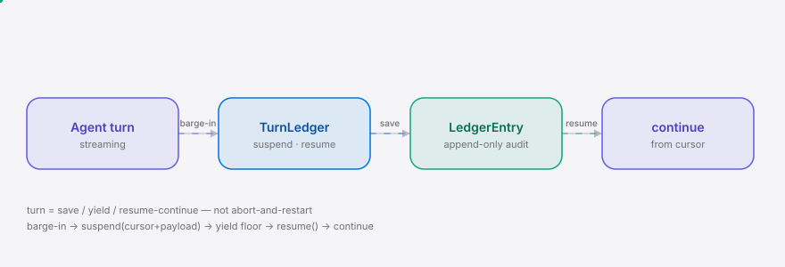
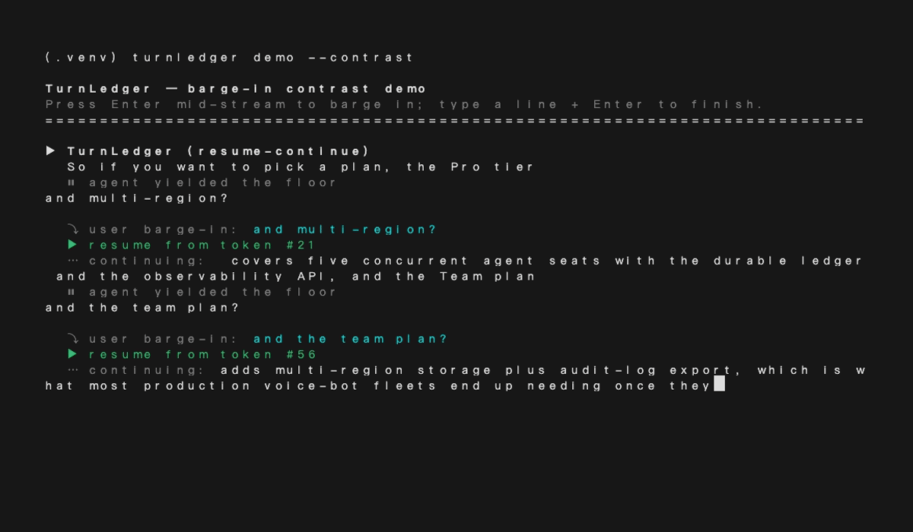

<div align="right"><sub><a href="./README.en.md">English</a>&nbsp;&nbsp;⇄&nbsp;&nbsp;<b>简体中文</b></sub></div>

<picture>
  <source media="(prefers-color-scheme: dark)" srcset="./assets/hero-dark.svg">
  <source media="(prefers-color-scheme: light)" srcset="./assets/hero-light.svg">
  
</picture>

<p align="center"><sub>面向实时语音 Agent 的中断-续接账本原语：被打断时让出话轮，说完后从中断处续接。</sub></p>

<p align="center">
  <a href="./LICENSE"></a>
  <a href="https://github.com/SuperMarioYL/turnledger/releases"></a>
  <a href="https://github.com/SuperMarioYL/turnledger/actions/workflows/ci.yml"></a>
  
  
  
</p>

**当用户中途插话，TurnLedger 让实时语音 Agent 挂起中间状态、让出话轮，并在用户说完后从被打断处续接——而非抢话，也非从头重启。**

> 推送后给仓库加 topic：`gh repo edit --add-topic agent --add-topic realtime --add-topic livekit --add-topic barge-in`

## 目录

- [架构](#架构)
- [为什么需要](#为什么需要)
- [安装与快速开始](#安装与快速开始)
- [用法](#用法)
- [Demo](#demo)
- [对比](#对比)
- [路线图](#路线图)
- [付费 / Pricing](#付费--pricing)
- [License](#license)

<h2> 架构</h2>

<picture>
  <source media="(prefers-color-scheme: dark)" srcset="./assets/atlas-dark.svg">
  <source media="(prefers-color-scheme: light)" srcset="./assets/atlas-light.svg">
  
</picture>

核心是 **interruption-continuation ledger（中断-续接账本）**：一个 append-only 的 `LedgerEntry` 流，在每次 barge-in 时捕获 Agent 挂起的中间步骤状态。同一 Agent 因此可以 *yield*（让出话轮）并在用户说完后 *resume-continue*（从中断处续接），而不是 abort-and-restart（弃掉重来）。

```python
TurnCursor(token_index, step_index, sub_step)   # 在一轮中被打断的位置
LedgerEntry(turn_id, seq, phase, cursor, payload, yielded_at, resumed_at)
TurnLedger.suspend(turn_id) -> LedgerEntry      # 捕获 cursor+payload，标记 yielded
TurnLedger.resume(turn_id) -> LedgerEntry | None # 重放最新挂起项，标记 resumed
TurnLedger.is_resumable(turn_id) -> bool
```

<h2> 为什么需要</h2>

实时语音 Agent 没有中断后续接的原语。今天的两种失败模式：**抢话**（无视用户继续说）或**弃掉重来**（abort 整轮，从头复述已经说过的内容）。后者是全双工语音助手（豆包 / 小爱 / 小布 / 传统 IVR）的默认行为——因为它们的轮次模型是 command→response，"重启"无害，因为没有值得保存的中间产物。续接只有当一轮变得**长、流式、带状态**时才有价值——而这个轮次模型在最近这一周期才真正落地。

TurnLedger 是 [langgenius/dify](https://github.com/langgenius/dify) 这类 Agent 编排器在语音路径上缺失的 save/yield/resume 原语——豆包 / 小爱 / 小布 同样是 drop-and-restart，这个 gap 语言无关。它定义的新动词是 **save / yield / resume-continue**，是 Temporal/DBOS（步骤级崩溃恢复）与 fork 原语（反事实分叉）结构性缺失的：前者粒度是秒级的 workflow step，后者语义是"分叉"而非"同一轮的挂起续接"。

<h2> 安装与快速开始</h2>

```bash
pip install turnledger
turnledger demo
# 流式输出中按 Enter 插话；输入一行 + Enter 结束，Agent 从被打断处续接
```

切换对比模式看默认的 drop-and-restart 行为：

```bash
turnledger demo --contrast     # 同一轮：续接 vs 重头重启，并排可见
```

<details><summary>示例输出</summary>

```
TurnLedger — barge-in contrast demo
Press Enter mid-stream to barge in; type a line + Enter to finish.
================================================================================
▶ TurnLedger (resume-continue)
  So if you want to pick a plan, the Pro tier covers five concurrent agent
  ⏸ agent yielded the floor
  ⤵ user barge-in: and multi-region?
  ▶ resume from token #14
  ⋯ continuing: seats with the durable ledger and the observability API, ...
  [ledger] turn=turn-demo suspended_entries=2

--------------------------------------------------------------------------------
▶ Default (drop-and-restart)
  So if you want to pick a plan, the Pro tier covers five concurrent agent
  ⏸ agent yielded the floor
  ⤵ user barge-in: and multi-region?
  ↻ restart (drop-and-restart default)
  ⋯ from the top: So if you want to pick a plan, the Pro tier covers ...
  [ledger] turn=turn-demo suspended_entries=1
```
</details>

<h2> 用法</h2>

**1. 进程内账本：三行接入 save/yield/resume**

```python
from turnledger import InMemoryLedger, TurnCursor

ledger = InMemoryLedger()
# Agent 流式输出时持续 report 当前 cursor
ledger.report("turn-1", cursor=TurnCursor(token_index=12, sub_step="llm:streaming"))
# 用户 barge-in：挂起并让出话轮
entry = ledger.suspend("turn-1")
# 用户说完：resume，从被打断的 token 续接
resumed = ledger.resume("turn-1")
assert resumed.cursor.token_index == 12
```

**2. 持久化审计日志（SQLiteStore）**

```python
from turnledger import SQLiteLedger

ledger = SQLiteLedger("turnledger.db")   # 跨重启持久化、可查询审计
ledger.suspend("turn-1", cursor=TurnCursor(token_index=12),
               payload={"partial_args": '{"query":"sel'})
# ledger.history("turn-1")  -> [yielding, resuming, ...] 全量中断历史
```

**3. LiveKit 语音 Agent（m2，ship target）**

```python
from turnledger import InMemoryLedger
from turnledger.adapters.livekit import LiveKitLedgerAgent

class MyVoiceAgent(LiveKitLedgerAgent):
    def __init__(self):
        super().__init__(
            instructions="你是一个实时的语音助手。",
            ledger=InMemoryLedger(),
            interruption_detection="adaptive",   # allow_interruptions=True + ML 检测
        )
    # OverlappingSpeechEvent(is_interruption=True) -> ledger.suspend()
    # on_user_turn_completed                   -> ledger.resume()
    # 单条 speech 覆盖：speech_handle.allow_interruptions = False
    # 单个工具调用覆盖：run_ctx.disallow_interruptions()
```

更多示例见 [`examples/text_barge_in_demo.py`](./examples/text_barge_in_demo.py)（无键盘、可复现的对比脚本）。

<h2> Demo</h2>



`docs/demo.tape` 是这条 10 分钟 happy path 的 [vhs](https://github.com/charmbracelet/vhs) 脚本；`.github/workflows/demo.yml` 在手动触发时重新渲染 `assets/demo.gif`。

<h2> 对比</h2>

TurnLedger vs [langgenius/dify](https://github.com/langgenius/dify)（zh 锚点仓库——中式 Agent 编排器，语音路径缺此原语）：

| 维度 | TurnLedger | langgenius/dify |
|---|---|---|
| save / yield / resume-continue 原语 | ✓ 原语级 | — drop-and-restart |
| 语音 barge-in 续接 | ✓ m2 LiveKit adapter | partial（有 barge-in，无续接） |
| Agent 编排广度 | — 单一原语 | ✓ 完整工作流 + 生态 |
| 持久化审计日志 | ✓ SQLiteStore | ✓ 更成熟 |
| 跨框架协议 | partial（m3 roadmap） | — |

dify 在编排广度与生态上明显更强；TurnLedger 只在一个动词上更深——被打断那一轮的续接。

<h2> 路线图</h2>

- [x] **m1** — 账本核心：`TurnCursor` / `LedgerEntry` / `InMemoryStore` + `SQLiteStore` + save/yield/resume `Protocol` + `turnledger demo` 文本流式 CLI（对比模式）
- [x] **m2** — LiveKit 语音 adapter（ship target）：`OverlappingSpeechEvent` → `ledger.suspend()`、`on_user_turn_completed` → `ledger.resume()`，配置于 `Agent(allow_interruptions=True, interruption_detection=...)`，单条 speech / 单个工具调用覆盖
- [ ] **m3** — 把 save/yield/resume 握手稳定为跨框架协议规格 + pipecat / dify adapter stub
- [ ] TurnLedger Cloud 托管后端（多区域账本 + 续接可观测性 API）
- [ ] TS / Rust / Go SDK 绑定（v0.1 仅 Python）

## 付费 / Pricing

OSS 库（`InMemoryStore` / `SQLiteStore` + 全部 adapter）MIT、永久免费——这是拥有 "save / yield / resume" 这个动词的方式。付费层是 **TurnLedger Cloud**：面向生产语音 Agent 集群的托管后端，提供多区域账本存储 + 续接连续性可观测性 API + 合规审计日志导出，**按并发 Agent 席位计费**。

| 层级 | 价格 | 说明 |
|---|---|---|
| Free | $0 | 10 席位，无需信用卡，面向独立开发者（OSS 库本身无限制） |
| Team | $499 / 月 | 500 席位 + 审计日志导出 |
| Usage | $0.02 / 席位·小时 | 托管账本 + 可观测性 API，月结（低于单次 LLM 调用成本） |

最小 "掏信用卡" 路径：`turnledger demo --voice livekit`（m2）→ 在 ops 负责人自己的 bot 上复现同一中断 → 展示 OSS `SQLiteStore` 里的 `LedgerEntry` 审计日志 → "Cloud 给你的就是这个：持久化 + 多区域 + 可观测性 API"。Cloud 后端本身在 v0.1 范围外（见 frontmatter out_of_scope）；落地页 + 定价在 m3 之前上线，使漏斗存在。

<h2> License</h2>

MIT，见 [`LICENSE`](./LICENSE)。提 issue / PR 见 [GitHub Issues](https://github.com/SuperMarioYL/turnledger/issues)。

## 分享

```
TurnLedger — 给实时语音 Agent 加 save/yield/resume-continue 原语。被打断时挂起状态、让出话轮，说完从中断处续接，而非抢话或重头开始。github.com/SuperMarioYL/turnledger
```

<p align="center"><sub><a href="./LICENSE">MIT</a> © 2026 SuperMarioYL</sub></p>
